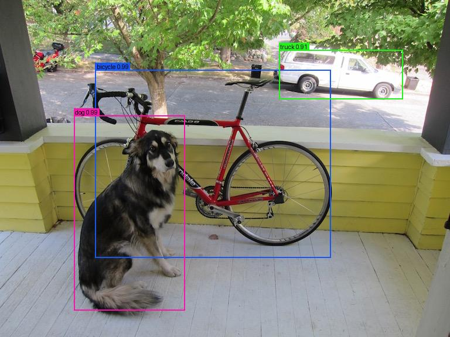

# YOLOv3

A from-scratch PyTorch implementation of
[*YOLOv3: An Incremental Improvement*](https://arxiv.org/abs/1804.02767) (Redmon & Farhadi, 2018):
the Darknet-53 backbone, three-scale detection head, training loss, Darknet-style data
augmentation and multi-scale training, COCO evaluation, anchor clustering, and
readers/writers for Darknet `.weights` files so the authors' released weights run unchanged.

## What is implemented

| Paper | Where |
|---|---|
| §2.1 Box prediction: `bx = σ(tx) + cx`, `bw = pw·e^tw`; squared-error coordinate loss; logistic objectness with one prior per ground truth and an ignore threshold of 0.5 | `yolov3/utils.py` (`decode`), `yolov3/loss.py` |
| §2.2 Class prediction: independent logistic classifiers trained with binary cross-entropy (no softmax) | `yolov3/loss.py`, `yolov3/utils.py` (`postprocess`) |
| §2.3 Predictions across 3 scales: upsample + concatenate with earlier feature maps, `N×N×[3·(4+1+80)]` outputs, 9 k-means priors | `yolov3/model.py` (`YOLOv3`), `yolov3/kmeans.py`, `kmeans_anchors.py` |
| §2.4 Darknet-53 feature extractor (Table 1) and ImageNet classifier | `yolov3/model.py` (`Darknet53`, `Darknet53Classifier`), `train_classifier.py` |
| §2.5 Training: full images, no hard-negative mining, multi-scale training, data augmentation, batch norm | `train.py`, `yolov3/data.py` |
| §3 Evaluation: COCO AP, AP50, AP75, APs/m/l at 320 / 416 / 608 | `evaluate.py`, `yolov3/metrics.py` |

Hyper-parameters the paper leaves to the code are taken from the authors' `yolov3.cfg`
and collected in `yolov3/config.py`: batch 64, SGD momentum 0.9, weight decay 5e-4,
learning rate 1e-3 with a 1000-iteration burn-in and ×0.1 at 400k and 450k of 500,200
iterations, jitter 0.3, hue 0.1, saturation/exposure 1.5, input size redrawn from 320–608
every 10 batches.

## Setup

```bash
pip install -r requirements.txt
```

## Detect

Works with the authors' released `yolov3.weights` or a checkpoint from `train.py`.

```bash
python detect.py --weights yolov3.weights --source dog.jpg --img-size 416
```

## Evaluate

```bash
python evaluate.py --weights yolov3.weights --ann annotations/instances_val2014.json --images val2014/ --img-size 608
```

`--ann` uses pycocotools for the official COCO numbers. `--list` takes a Darknet-format
image list instead and uses the built-in AP implementation.

## Train

Darknet-53 is first trained on ImageNet, then the detector is trained on COCO starting
from that backbone (`darknet53.conv.74`).

```bash
python train_classifier.py --train imagenet/train --val imagenet/val --export
```

```bash
python train.py --ann annotations/instances_train2014.json --images train2014/ --weights darknet53.conv.74
```

The loss is summed over a batch and divided by the batch size, as in Darknet, so the
default learning rate of 1e-3 assumes batch 64. With a smaller batch, scale `--lr` down
in proportion (e.g. `--batch-size 8 --lr 1.25e-4`); at batch 8, lr 1e-3 diverges.

For your own data, cluster anchors with `kmeans_anchors.py`, and pass `--list train.txt
--num-classes N` (Darknet format: one image path per line, labels in the parallel
`labels/` directory as `class cx cy w h`, normalised).

## Verification

- `pytest tests` — 14 tests covering the architecture (61,949,149 parameters, the size
  of the reference network), loss, target assignment, ignore threshold, decoding, NMS,
  AP, augmentation, schedule and weight I/O.
- **Authors' weights.** The released `yolov3.weights` (248,007,048 bytes) loads with
  every value consumed, and reproduces Darknet's familiar detections on `dog.jpg` at
  416: bicycle 0.99, dog 0.99, truck 0.91.

  
- **Loss.** On 16 COCO images the loss at the authors' weights is about 10 per image,
  against about 7,700 with an untrained head, so the objective agrees with the one
  those weights were trained on.
- **Training.** A 600-iteration CPU run on a 128-image COCO subset, starting from the
  pretrained backbone (batch 8, 320 px, lr 1.25e-4), took the loss from about 5,400 to
  about 40 and reached AP50 0.24 / AP 0.09 on those same training images. This shows
  the training path learns; it says nothing about accuracy on held-out data.

Not verified: the paper's COCO test-dev numbers (Table 3) and a full 500k-iteration
training run. Neither COCO nor a GPU was available where this was written; only a
128-image COCO subset was used for smoke tests.

## Where this follows the code rather than the paper text

- **Coordinate weighting.** Darknet scales each box's coordinate loss by `2 − w·h` so
  small boxes count more. The paper does not mention it; it is on by default
  (`YOLOv3Loss(box_scale=False)` turns it off).
- **x/y loss.** The paper says squared error, which is the default. Darknet's gradient
  for x/y is actually that of a cross-entropy; `--xy-loss bce` selects that.
- **Ignore threshold.** The paper says 0.5 (the default here); the released
  `yolov3.cfg` uses 0.7 (`--ignore-thresh 0.7`).
- **Dual assignment.** Per the paper, each ground truth is assigned to exactly one prior
  (the best of all nine), not to every prior above a threshold as in Faster R-CNN.
